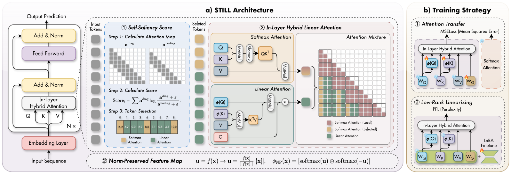
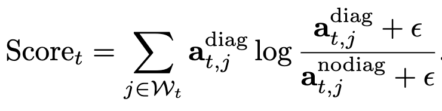
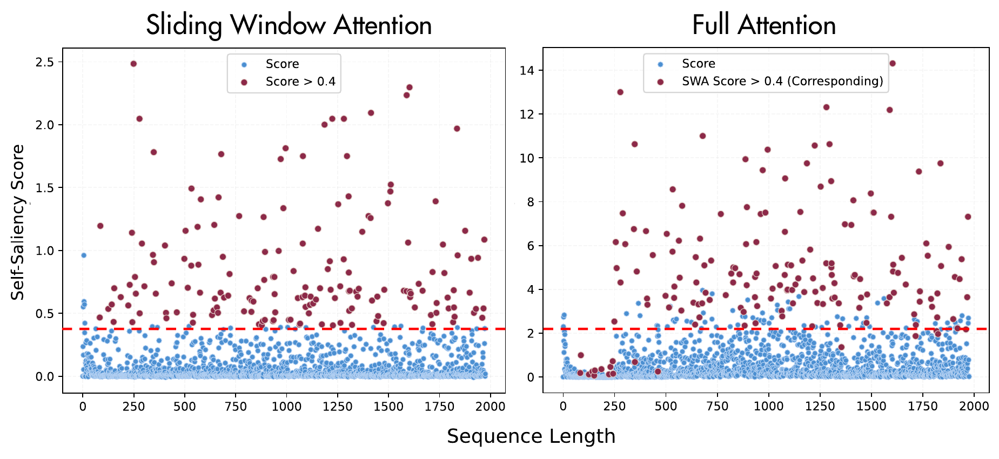
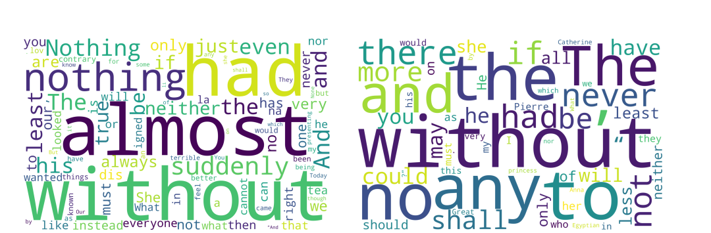
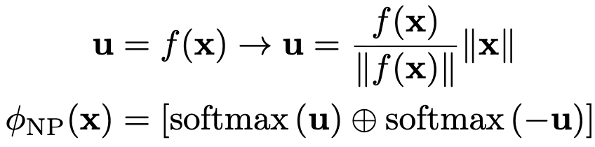
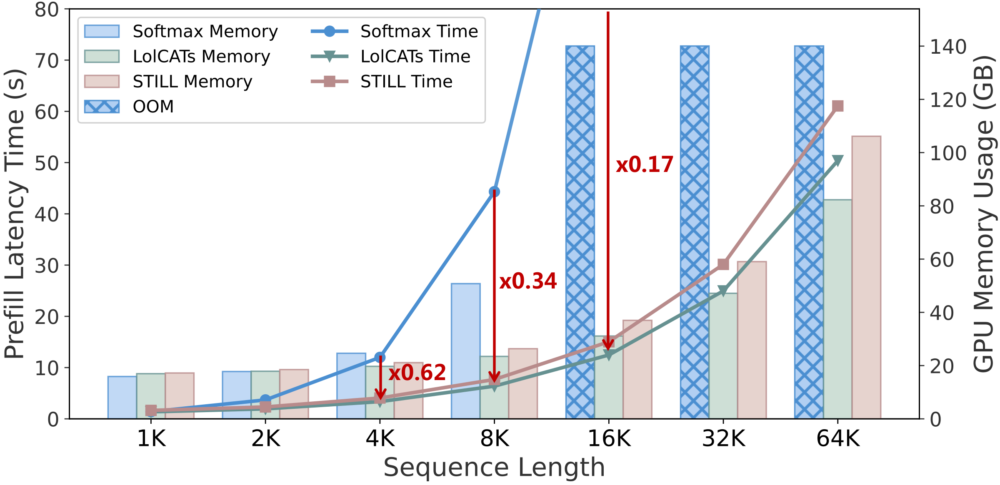
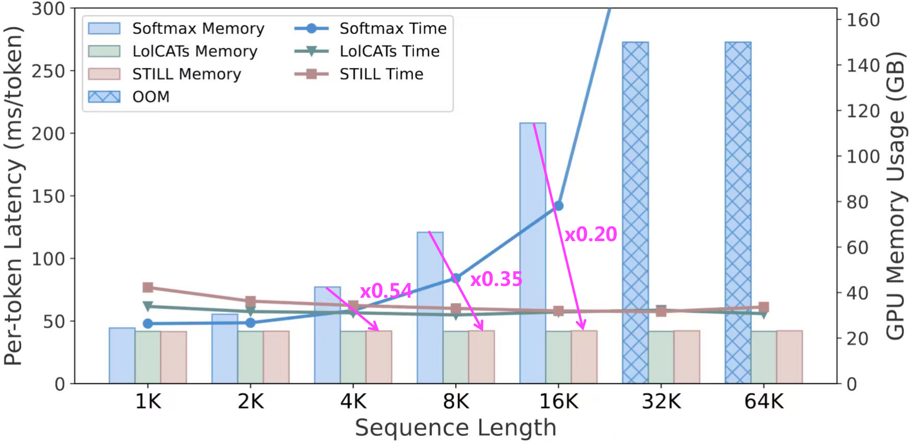

<div align="center">

<h1>STILL: Selecting Tokens for Intra-Layer Hybrid Attention to Linearize LLMs</h1>


<p>
  <strong>🚀 This repository contains the official code for <strong>STILL</strong>.</strong><br>
  <strong>⭐ If you like our work, please support us with a star</strong>
</p>


<p>
  <a href="https://arxiv.org/abs/2602.02180"></a>
  <a href="https://arxiv.org/pdf/2602.02180"></a>
  
  <a href="https://github.com/ZacharyMeng/STILL/stargazers"></a>
</p>

</div>

## 🔥 News
- [2026.09]   🔥 **STILL** has been accepted to NeurIPS 2026, and the complete paper will be released soon!


## Overview

Large Language Models (LLMs) suffer from quadratic computational complexity ($\mathcal{O}(N^2)$) in standard Softmax Attention, which limits scalability to long sequences. Existing intra-layer hybrid attention methods for LLM linearization face two critical challenges:

1. **Position-based token routing:** Sliding-window-based token selection fails to capture token-specific global importance, discarding crucial non-local tokens from high-fidelity Softmax Attention (SA).
2. **Norm distortion in Linear Attention:** Learnable feature maps in Linear Attention (LA) distort pretrained feature magnitudes, breaking the *norm-aware* property of pretrained LLMs and degrading performance.

To address these limitations, we propose **STILL**, an intra-layer hybrid linearization framework that achieves linear complexity while largely retaining the reasoning and long-context capabilities of pretrained LLMs. Its central idea is simple: reserve a bounded Softmax Attention budget for recent and content-salient tokens, while compressing the remaining history into a Linear Attention state.

<p align="center">
  
</p>

<p align="center"><sub><b>STILL at a glance.</b> Content-aware routing, norm-preserved linear features, and a unified chunk-wise training–inference architecture.</sub></p>

---

## Method

STILL turns this idea into three complementary components.

### 1. Content-Aware Routing with Self-Saliency

We design a **Self-Saliency Score** with strong local–global consistency to estimate token importance using only sliding-window computation. This score quantifies how much a token relies on its self-attention term, enabling reliable selection of salient tokens for SA (high-fidelity modeling) while routing the rest to LA (efficient summarization) — replacing heuristic position-based routing.

Formally, the Self-Saliency Score is computed by comparing sliding-window attention distributions with and without the diagonal (self-attention) term:

<p align="center">
  
</p>

where $\mathcal{W}_t$ is the local window index set, $\mathbf{a}^{\mathrm{diag}}$ and $\mathbf{a}^{\mathrm{nodiag}}$ are attention distributions with and without the self-attention term, and $\epsilon$ is a small constant for numerical stability.

As $\epsilon\to0^{+}$, the score is strictly monotonic in the local self-attention probability and rank-preserving in expectation with respect to global self-attention probability. This provides the theoretical basis for using locally computed scores as a proxy for global token importance.

<p align="center">
  
  <br>
  <sub><b>Local–global consistency.</b> Tokens identified as salient using Sliding-Window Attention largely remain salient under Full Attention, allowing global importance to be approximated with local computation.</sub>
</p>

<p align="center">
  
  <br>
  <sub><b>What does STILL select?</b> Frequently selected SA tokens are dominated by functional operators involving negation, modality, and quantification—tokens that benefit from precise, context-dependent interactions.</sub>
</p>

### 2. Norm Preservation with NP-Map

To preserve pretrained norm statistics, we propose **NP-Map**, which decouples feature direction from magnitude and reinjects pretrained norms into Linear Attention feature maps:

<p align="center">
  
</p>

where $f(\cdot)$ is the learnable MLP in the feature map. NP-Map ensures Linear Attention aligns with the pretrained model's representational intensity while satisfying non-negativity constraints.

STILL additionally applies a learnable gate to the Linear Attention output, improving its effective rank while retaining linear complexity.

### 3. Hardware-Efficient Chunk-Wise Execution

We adopt **chunk-wise parallelization** and **delayed selection** to improve hardware efficiency:

- **Chunk-wise parallel form:** Sequences are split into chunks for parallel computation of saliency scores and hybrid attention, unifying training and inference logic while maintaining linear complexity.
- **Delayed selection:** Token routing is performed at chunk granularity instead of per token during decoding, reducing overhead and improving parallelism.

The selected tokens contribute exact Softmax Attention terms, while unselected history contributes through the recurrent Linear Attention state. STILL adds the numerators and denominators from both branches before normalization, allowing the two paths to complement each other without discarding unselected context.

#### Why Chunk-Wise Selection Matters

The key advantage of STILL is not simply *selecting fewer tokens*, but making selection **content-aware, fixed-budget, and hardware-friendly** at the same time. For each completed chunk of $C$ tokens, every attention head independently keeps the top-$\lambda$ tokens with the highest Self-Saliency Scores in the sparse SA cache; the remaining $C-\lambda$ tokens are accumulated into the recurrent LA state.

Given the maximum context length $N_{\max}$, Softmax cache budget $m$, and local window size $W$, STILL sets

$$
T_{\max}=\left\lceil\frac{N_{\max}}{C}\right\rceil,
\qquad
\lambda=\left\lfloor\frac{m-W}{T_{\max}}\right\rfloor.
$$

For any runtime sequence length $N\leq N_{\max}$, the number of completed chunks is $T=\lceil N/C\rceil$, so $T\lambda\leq T_{\max}\lambda\leq m-W$. The total Softmax cache therefore never exceeds $m$: recent tokens occupy $W$ slots, selected historical tokens occupy at most $m-W$ slots, and the remaining history is summarized in the compact LA state. Routing is performed independently for every attention head. Once selected, a salient token remains in the SA cache without being rescored or evicted; unselected tokens are accumulated into the recurrent LA state.

The same routing rule is shared by parallel training, prompt prefilling, and recurrent decoding. Combining the fixed-budget SA branch, the LA branch, and delayed selection gives linear overall complexity:

$$
\mathcal{O}(Nmd)+\mathcal{O}((N-m)dd^{\prime})+\mathcal{O}(T\log(C))=\mathcal{O}(N).
$$

Here, $d$ is the attention-head dimension and $d^{\prime}$ is the feature-map output dimension.

---

## Results

STILL preserves short-context reasoning, restores long-context capability, and delivers favorable memory–speed trade-offs.

| Reasoning | Long context | Efficient adaptation |
|:--:|:--:|:--:|
| **+10.5 MMLU points** over LoLCATs on Llama 3.1 8B | **86.2% S-NIAH-1 accuracy at 4K** with a total cache of at most 512 tokens | Only **0.04B (40M) training tokens** in the primary 8B experiments |

### Benchmark Highlights

- **Reasoning Tasks:** Retains strong commonsense and general reasoning performance across PIQA, ARC-E/C, HellaSwag, WinoGrande, and MMLU. On Llama 3.1 8B, STILL improves the average commonsense score excluding MMLU from **73.2 to 74.7** relative to the pretrained model and gains **10.5 MMLU points over LoLCATs**.
- **Long-Context Tasks:** Restores long-context capability across RULER and BABILong. On S-NIAH-1, STILL reaches **86.2% at 4K** with a total cache of at most 512 tokens, while the compared linearized baselines largely fail.
- **Architectural Compatibility:** In the separate proportional-budget compatibility setting, combining STILL with the KL-LS inter-layer strategy on Llama 3.2 1B scores **100 on S-NIAH-1 from 4K to 16K** and reaches **27.20 on 16K RULER**, compared with 13.37 for Zebra-Llama.
- **Efficiency:** Uses only **0.04B training tokens** for Llama 3/3.1 8B linearization, while scaling prefilling and decoding smoothly to **64K** context in the efficiency evaluation.

### Routing Quality Under a Fixed Cache Budget

The advantage becomes especially clear when the cache budget is tight and remote evidence must be retained. On long-context S-NIAH-1 with the same 128-token cache budget, Self-Saliency substantially outperforms diagonal attention, query–key similarity, key norm, uniform selection, and random selection:

| Routing metric | 0.5K | 1K | Average |
|:--|--:|--:|--:|
| **Self-Saliency** | **63.2** | **22.0** | **42.6** |
| Diagonal attention | 35.6 | 10.6 | 23.1 |
| $\mathbf{q}_t^\top\mathbf{k}_t$ | 35.4 | 10.2 | 22.8 |
| Key norm | 18.6 | 7.1 | 12.9 |
| Uniform per chunk | 17.8 | 6.8 | 12.3 |
| Random selection | 18.6 | 7.0 | 12.8 |

This shows that the gain does not come from chunking alone: the **selection criterion** is essential for preserving distant, routing-sensitive information.

> **Future-KV utility.** Across representative heads in shallow, middle, and deep layers, the Top-224 tokens selected causally from local Self-Saliency overlap with **62.9%–84.8%** of the Top-224 remote keys later prioritized by future Full Attention queries.

### Accuracy–Efficiency Trade-off Across Chunk Sizes

We evaluate different chunk sizes $C$ using the same checkpoint and a fixed budget of 16 selected remote tokens. Accuracy is measured on commonsense reasoning, while time and memory are measured per training step on a single NVIDIA A6000:

| Chunk size $C$ | Avg. w/ MMLU ↑ | Time (s/step) ↓ | Memory (GB) ↓ |
|--:|--:|--:|--:|
| 16 | 69.6 | 14.7 | 37.4 |
| **64 (default)** | **72.3** | 9.7 | 30.6 |
| 128 | 72.1 | **9.5** | **29.3** |

Moderate delayed selection introduces no systematic accuracy loss: performance improves from $C=16$ to $C=64$ and remains close at $C=128$. Increasing $C$ from 16 to 128 reduces training time by **35.4%** and memory by **21.7%**. In contrast, exact per-token routing ($C=1$) increases decoding selection latency by more than **3×** and reduces training speed by more than **50%**; $C=4$ runs out of memory. We use $C=64$ by default as the best balance between routing quality and hardware efficiency.

### Prefilling and Decoding Efficiency from 1K to 64K

Efficiency is evaluated on a single NVIDIA H200 across sequence lengths from 1K to 64K. The fixed-budget sparse SA cache prevents memory from growing quadratically, while chunk-wise and delayed selection keep routing overhead small.

<table>
  <tr>
    <td width="50%" align="center">
      <a href="figures/prefilling_efficiency.png"></a>
    </td>
    <td width="50%" align="center">
      <a href="figures/decoding_efficiency.png"></a>
    </td>
  </tr>
  <tr>
    <td valign="top"><b>Prefilling efficiency.</b> STILL scales to 64K and requires only 17% of the Softmax runtime at 16K, with marginal overhead over LoLCATs.</td>
    <td valign="top"><b>Decoding efficiency.</b> STILL keeps a nearly constant memory footprint through 64K and uses only 20% of the Softmax memory at 16K.</td>
  </tr>
</table>

Together, the two phases expose the practical value of chunk-wise selection:

- **Efficient prefilling:** Selection and hybrid attention are computed chunk by chunk in parallel, avoiding a serial routing decision for every token.
- **Stable decoding:** Delayed selection bounds the sparse SA cache; STILL maintains near-constant memory through 64K and stable decoding throughput as context grows.
- **Long-context scalability:** Softmax reaches its memory limit beyond 16K during prefilling and runs out of memory beyond 32K during decoding, while STILL continues to 64K in both phases.

Compared with LoLCATs, STILL introduces only marginal latency and memory overhead while recovering substantially stronger long-context accuracy. Compared with Full Softmax Attention, it retains a much more favorable memory–speed profile as the context grows.

---

<a id="environment"></a>

## ⚙️ Environment

Prepare the Python environment and install the dependencies:

```bash
# Create and activate the environment
conda create -n still python=3.10 -y
conda activate still

# Install project dependencies
pip install -r requirements.txt
pip install flash-attn --no-build-isolation
```

### Third-Party Dependencies

STILL directly imports the Triton kernels provided by [Flash Linear Attention](https://github.com/fla-org/flash-linear-attention). The `third_party/` directory is empty by default, so install the dependency locally before training or inference:

```bash
# Required for training and inference
mkdir -p third_party
git clone https://github.com/fla-org/flash-linear-attention.git \
  third_party/flash-linear-attention
pip install -e third_party/flash-linear-attention
```

The evaluation harness is optional and only required for benchmark evaluation:

```bash
# Optional: required for evaluation
git clone https://github.com/EleutherAI/lm-evaluation-harness.git \
  third_party/lm-evaluation-harness
pip install -e third_party/lm-evaluation-harness
```

These editable installations keep STILL self-contained and avoid relying on external repository paths in `PYTHONPATH`.

---

<a id="training"></a>

## 📚 Training

STILL uses a two-stage training pipeline. **Stage 1 (Attention Transfer)** freezes the teacher model and trains the NP-Map feature and gating projections by minimizing layer-wise MSE against the original attention module. **Stage 2 (Low-rank Linearization)** performs end-to-end LoRA fine-tuning over the query, key, value, output, and gating projections. In the primary setup, both stages use Cleaned Alpaca with a sequence length of 1024 and **20M tokens per stage (40M, or 0.04B, in total)**.

Preparing and launching the two stages involves four steps:

1. **Prepare the base model**

   Place the model weights (for example, Llama-3.1-8B) under `./checkpoints/` and rename the directory to `still_llama31_8B_base`.

2. **Modify the model configuration**

   Edit `./checkpoints/still_llama31_8B_base/config.json` and update:

   ```json
   {
     "architectures": ["StillModelForCausalLM"],
     "model_type": "still"
   }
   ```

3. **Adjust the training configurations**

   Set `model.pretrained_model_name_or_path` and other training options in:

   - `configs/still_at_step1.yaml` for Stage 1; point it to the prepared base model.
   - `configs/still_ar_step2.yaml` for Stage 2; point it to the Stage 1 checkpoint.

4. **Launch training**

   ```bash
   # Stage 1: Attention Transfer
   CUDA_VISIBLE_DEVICES=0 python run.py --cfg configs/still_at_step1.yaml

   # Stage 2: Low-Rank Linearization
   CUDA_VISIBLE_DEVICES=0 python run.py --cfg configs/still_ar_step2.yaml
   ```

   Replace `0` with the physical GPU index you want to use.

---

## Acknowledgements

This code is developed on top of [LoLCATs](https://github.com/HazyResearch/lolcats) and [Liger](https://github.com/OpenSparseLLMs/Linearization).

## Citation

If you find this repository helpful, please consider citing our work:

```latex
@inproceedings{meng2026still,
  title={STILL: Selecting Tokens for Intra-Layer Hybrid Attention to Linearize LLMs},
  author={Weikang Meng and Liangyu Huo and Yadan Luo and Jiawen Guan and Jingyi Zhang and Yingjian Li and Zheng Zhang},
  booktitle={Advances in Neural Information Processing Systems (NeurIPS)},
  year={2026}
}
```
